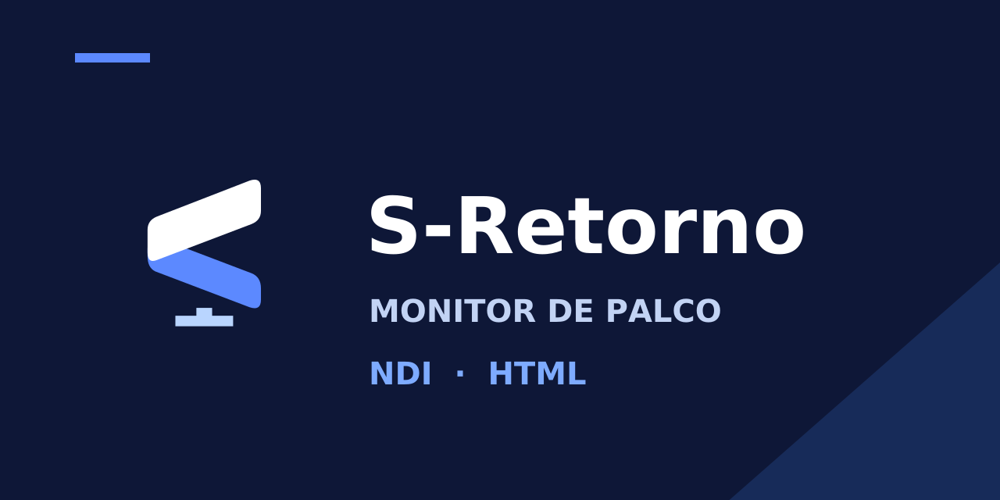

# S-Retorno

Use sua TV, TV Box ou celular Android como monitor de retorno para igrejas e eventos. O S-Retorno recebe fontes **NDI** e exibe saídas **HTML do S-Present** pela rede local.

## Baixar o aplicativo

### [⬇️ Baixar S-Retorno 1.4.12 — APK pronto para instalar](https://github.com/gedielsonsaramento/S-Retorno.apk/raw/refs/heads/downloads-1.4.12/S-Retorno-1.4.12.apk)

O arquivo acima já vem pronto para instalar e usar no aparelho.

## Compatibilidade

| Versão do aparelho | Modos disponíveis |
| --- | --- |
| **Android 6** | **HTML** |
| **Android 7 ou superior** | **HTML e NDI** |

Mantenha o aparelho e o computador com o S-Present ou transmissor NDI na **mesma rede**, por Wi-Fi ou cabo.

## Como instalar

1. Baixe o **APK** pelo link acima.
2. No celular, abra o arquivo baixado. Para TV/box, você pode copiá-lo para um pendrive e abrir pelo gerenciador de arquivos.
3. Se o Android solicitar, permita a instalação por esse navegador ou gerenciador de arquivos.
4. Toque em **Instalar** e abra **S-Retorno**.

**Para atualizar as edições TVBox anteriores, instale por cima, sem desinstalar**, para manter as fontes e configurações salvas.

## Como configurar as fontes HTML

Faça esta configuração em cada TV ou box para listar todas as saídas HTML do seu S-Present:

1. No S-Retorno, selecione **HTML** e abra **engrenagem → Saídas HTML do S-Present → Configurar pelo celular ou PC**.
2. Deixe essa tela aberta: ela mostra um **endereço** e um **código de seis dígitos**.
3. No computador com o S-Present, abra **Editor remoto (rede)** e use **Copiar link com token**.
4. No navegador do PC ou celular da mesma rede, abra o **endereço mostrado na TV/box**. Informe o código e cole o link completo copiado do S-Present.
5. Toque em **Enviar para esta TV**. Volte à lista do app e selecione a saída desejada.

O código vale por cinco minutos. Se expirar, abra novamente **Configurar pelo celular ou PC** para gerar outro.

[Passo a passo completo para encontrar o link no S-Present](docs/SAIDAS_SPRESENTER.md).

## Como buscar novas fontes HTML

1. Crie ou habilite a nova **Saída HTML** no S-Present.
2. No app, abra o painel de fontes, mantenha **HTML** selecionado e toque em **↻ no topo do painel**.
3. Aguarde a lista atualizar e selecione a fonte que deseja exibir.

Com o computador configurado pelo procedimento acima, a busca encontra novas saídas e atualiza seus nomes. Se mudar também o endereço de uma saída, selecione a nova entrada na lista.

O app salva a fonte escolhida e a abre novamente na próxima inicialização. Para abrir um link HTML diretamente, use **Informar endereço** e cole o endereço completo da saída.

## Como usar NDI

Em aparelhos com **Android 7 ou superior**, deixe o transmissor NDI ativo no computador, selecione **NDI** no app, toque em **↻** para procurar fontes e escolha a desejada.

## Relatar um problema

Abra **engrenagem → Relatar problema**, escolha o tipo de falha e use **Copiar relatório**. O relatório mostra a versão e o consumo de memória, CPU e rede do próprio app.

O envio ao suporte e o compartilhamento automático estão preparados para um servidor próprio, ainda em construção. **Nesta versão, não há envio remoto de métricas.** Quando o servidor estiver disponível, o compartilhamento será opcional e visível no app.

## Testes e atualizações semanais

**Realizamos testes e disponibilizamos novas atualizações toda semana** para melhorar o funcionamento, a compatibilidade e a estabilidade do aplicativo.

Nos testes relatados pelo mantenedor, todas as boxes utilizadas e a TV Philips com Android funcionaram corretamente. [Ver o registro dos testes](docs/TESTES_EM_APARELHOS.md).

Se encontrar uma dificuldade, copie o relatório do app e [relate o problema aqui](https://github.com/gedielsonsaramento/S-Retorno.apk/issues).

Código-fonte e documentação técnica

- [Baixar o código-fonte da versão 1.4.12 — ZIP](https://github.com/gedielsonsaramento/S-Retorno.apk/archive/refs/heads/versao-1.4.12.zip)
- [Documentação completa e instruções de compilação](docs/README.md)
- [Detalhes do download e integridade do APK](docs/DOWNLOADS.md)
- [Histórico de alterações](docs/CHANGELOG.md)
- [Registros de validação](docs/historico/README.md)

Projeto independente. Código próprio sob [licença MIT](LICENSE). NDI® é marca registrada da Vizrt NDI AB; os componentes NDI têm [termos e avisos próprios](docs/LICENCA_NDI_IMPORTANTE.md).
